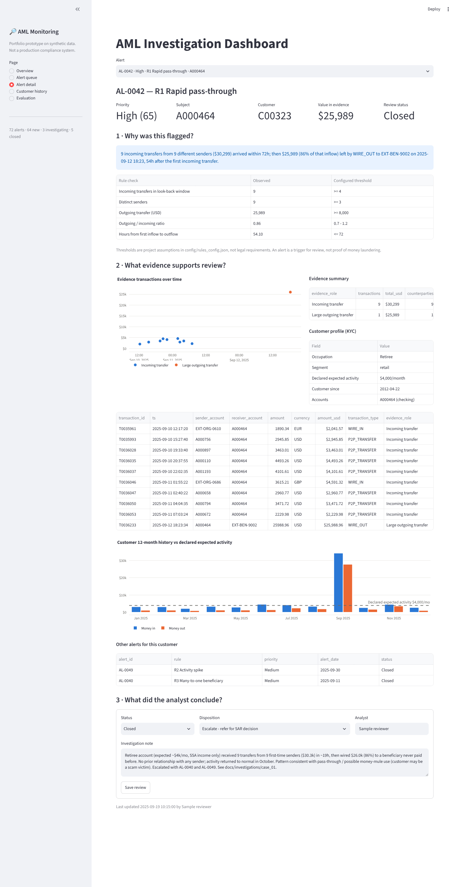
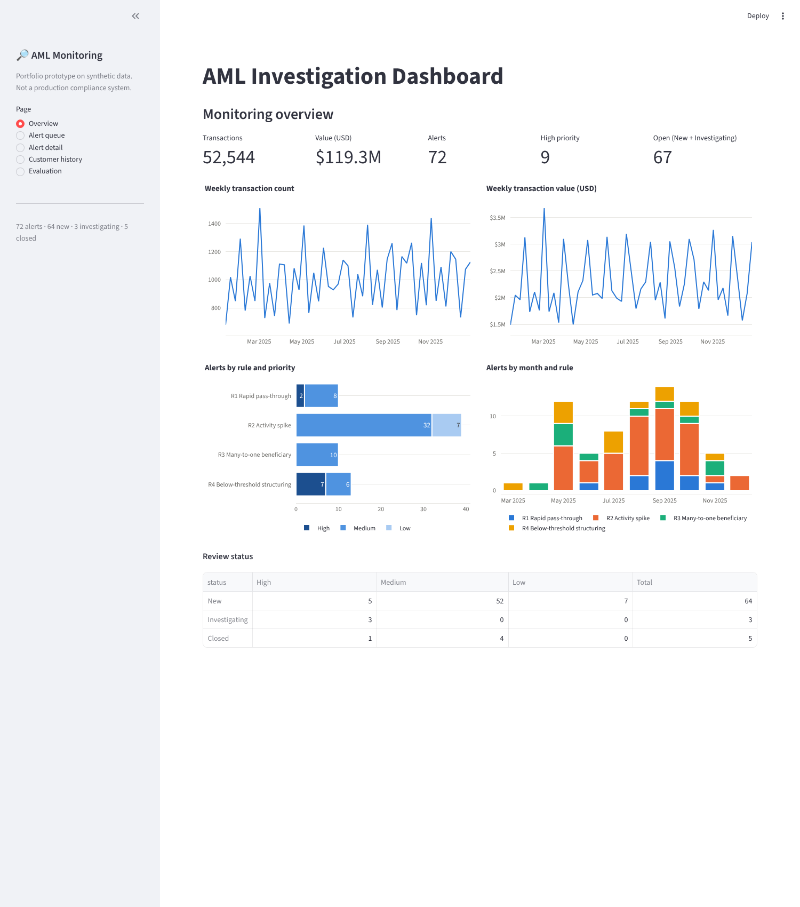
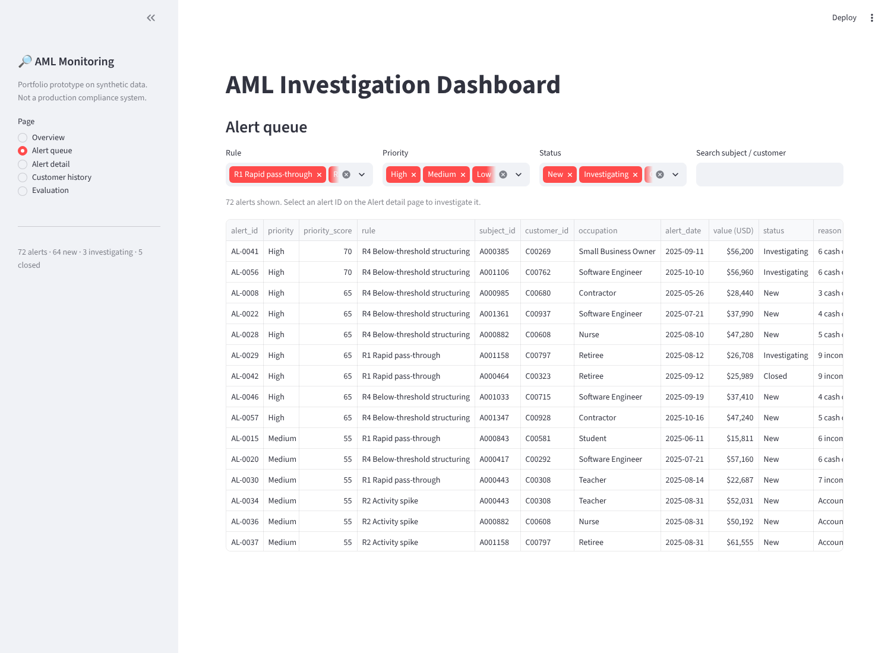
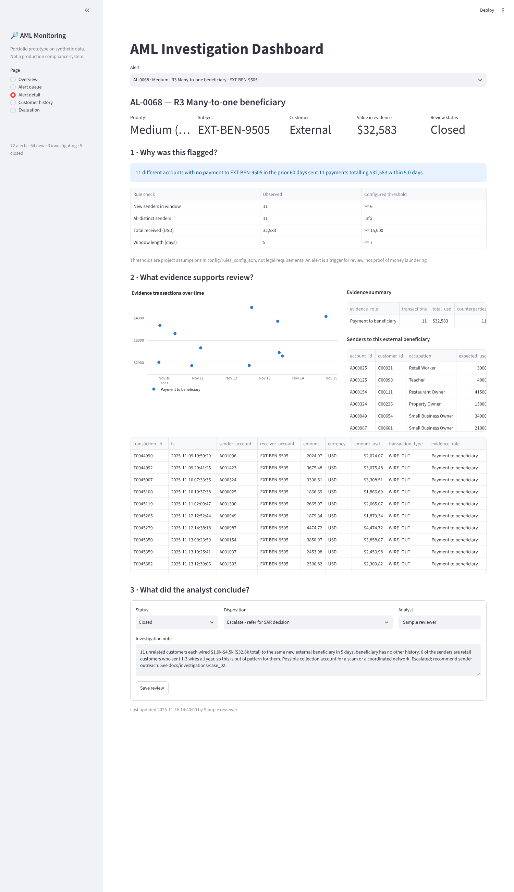
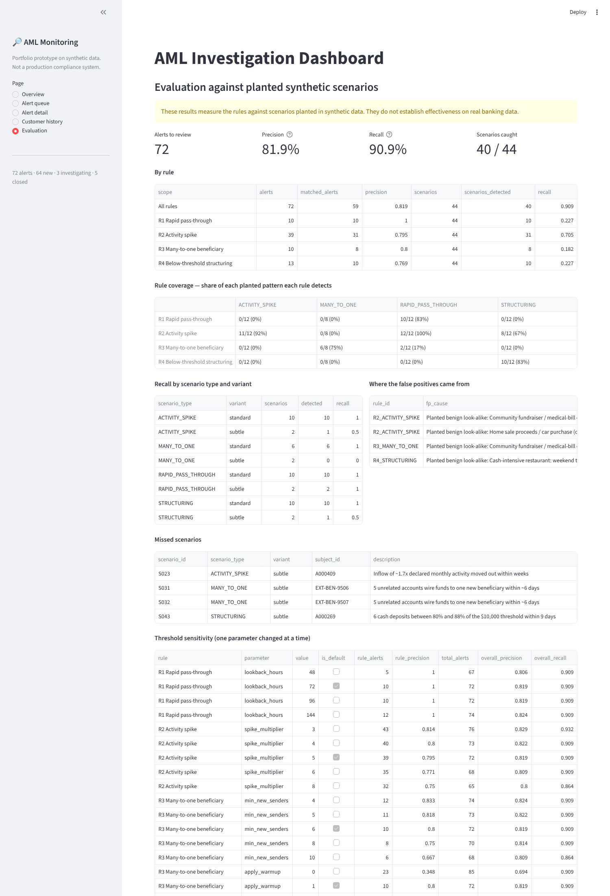

# AML Transaction Monitoring Prototype

**Explainable rules that flag unusual patterns in synthetic banking transactions, plus an investigation dashboard where an analyst can see why each alert fired, review the evidence, and record a conclusion.**

`Python` · `SQL (SQLite)` · `pandas` · `Streamlit` · `Plotly`

> ⚠️ **Portfolio prototype on synthetic data.** This is not a production compliance system, and it does not use real customer records.
> Thresholds are project assumptions, not legal requirements. An alert is a trigger for investigation, not proof of money laundering.



---

## The problem
Banks have to spot transaction patterns that may point to money laundering, then have analysts review them. Two things make that hard:
1. **Volume.** Each alert costs analyst time, so rules need to catch real patterns without burying the team in noise.
2. **Explainability.** An analyst (and later an auditor) must be able to see *exactly* why a customer was flagged and what the reviewer decided.

This project builds a small end-to-end version of that workflow: generate data → run rules in SQL → score and explain alerts → review them in a dashboard → measure how well the rules worked.

## What's inside
| Step | What it does | Where |
|---|---|---|
| 1. Synthetic data | 1,000 customers, 1,458 accounts, **52,544 transactions** (2025) with **44 planted suspicious scenarios** and **19 benign look-alikes** | `src/01_generate_data.py` |
| 2. Load | SQLite schema, indexes, ground-truth tables, reporting views | `sql/00_schema.sql`, `sql/05_reporting_views.sql`, `src/02_load_sqlite.py` |
| 3. Monitoring rules | 4 explainable rules written in SQL, parameters in one config file | `sql/01–04_rule_*.sql`, `config/rules_config.json` |
| 4. Alerts | Merge rule hits, attach evidence transactions, priority score, plain-English reason | `src/03_run_rules.py` |
| 5. Evaluation | Precision, recall, alert volume, rule coverage, threshold sensitivity | `src/04_evaluate.py`, `docs/evaluation.md` |
| 6. Dashboard | Overview, alert queue, **alert detail page**, customer history, evaluation | `app/streamlit_app.py` |
| 7. Investigations | Three sample case write-ups | `docs/investigations/` |

## Monitoring rules
| Rule | Flags… | Default thresholds (assumptions) |
|---|---|---|
| **R1 Rapid pass-through** | Several incoming transfers followed by one large outgoing transfer | ≥ 4 credits from ≥ 3 senders within 72h, then an outflow ≥ $8,000 that is 70–120% of the inflow |
| **R2 Activity spike** | An account suddenly transacting far above its usual activity | Month ≥ 5x its trailing 3-month average **and** ≥ 3x declared expected activity **and** ≥ $20,000 |
| **R3 Many-to-one** | Many accounts sending funds to the same beneficiary | ≥ 6 senders with no payment to that beneficiary in the prior 60 days, ≥ $15,000, within 7 days |
| **R4 Structuring** | Repeated deposits just below a configurable threshold | ≥ 3 cash deposits at 90–100% of a $10,000 threshold within 10 days |

Every threshold is in `config/rules_config.json`. Rationale and the priority-scoring formula: [`docs/assumptions_and_thresholds.md`](docs/assumptions_and_thresholds.md).

Example of the reason text stored with each alert:
> *9 incoming transfers from 9 different senders ($30,299) arrived within 72h; then $25,989 (86% of that inflow) left by WIRE_OUT to EXT-BEN-9002 on 2025-09-12 18:23, 54h after the first incoming transfer.*

## Results on the planted scenarios
| Metric | Value |
|---|---|
| Alerts an analyst would review | **72** (51 distinct subjects) |
| Precision | **81.9%** (59 of 72 alerts matched a planted scenario) |
| Recall | **90.9%** (40 of 44 scenarios caught) — 100% of standard, 50% of deliberately subtle scenarios |
| Rule coverage | Each pattern is caught best by its own rule (75–92%); R2 also catches 100% of pass-through cases as a safety net |

All 13 false positives came from planted benign look-alikes (home sale, fundraiser, cash-heavy restaurant). Adding a 60-day **warm-up** to R3 removed 13 cold-start alerts (85 → 72) without losing any scenario. Details, misses and sensitivity analysis: [`docs/evaluation.md`](docs/evaluation.md).

> **These results are on synthetic scenarios I designed. They do not show how the rules would perform on real banking data.**

## Investigation dashboard
The alert detail page answers three questions for every alert:
1. **Why was this customer flagged?** Plain-English reason + each rule check with its observed value and configured threshold.
2. **What evidence supports review?** Evidence transactions (timeline + table), KYC profile, 12-month history against declared expected activity, other alerts on the same customer, or — for an external beneficiary — the profile of every sender.
3. **What did the analyst conclude?** Status (New / Investigating / Closed), disposition, and an investigation note, saved to the database.

| Overview | Alert queue |
|---|---|
|  |  |
| **External beneficiary alert** | **Evaluation** |
|  |  |

Customer history page: [`screenshots/05_customer_history.png`](screenshots/05_customer_history.png)

## Sample investigations
| Case | Alert | Outcome |
|---|---|---|
| [Rapid pass-through on a retiree account](docs/investigations/case_01_rapid_pass_through_AL-0042.md) | AL-0042 (+ AL-0040, AL-0049) | Escalate — refer for SAR decision |
| [11 customers wiring one new beneficiary](docs/investigations/case_02_many_to_one_AL-0068.md) | AL-0068 | Escalate — possible scam collection account |
| [Restaurant cash deposits near the threshold](docs/investigations/case_03_restaurant_cash_AL-0001.md) | AL-0001 | Closed — no further action (false positive) |

## Run it
```bash
pip install -r requirements.txt
./run_all.sh                         # generate data, build DB, run rules, evaluate (~1 min)
streamlit run app/streamlit_app.py   # open the dashboard
```
Deep links: `?page=Alert+detail&alert=AL-0042`, `?page=Customer+history&customer=C00323`.

## Repository layout
```
config/rules_config.json      thresholds, priority weights, FX rates
src/                          01 generate · 02 load · 03 run rules · 04 evaluate · common.py
sql/                          schema, one file per rule (triggers + evidence queries), reporting views
app/streamlit_app.py          investigation dashboard
data/raw/                     customers, accounts, transactions (synthetic)
data/labels/                  planted scenarios, planted transactions, benign look-alikes
data/reviews/seed_reviews.csv sample analyst reviews
outputs/                      alerts, evidence, evaluation tables
docs/                         data dictionary, assumptions, evaluation, investigations
screenshots/                  dashboard screenshots
```

## Limitations
- Synthetic data with self-designed scenarios; real behaviour is noisier and typologies are unknown in advance.
- No balances, devices, IP addresses, geography, or KYC documents.
- Batch processing over a single year; no real-time monitoring.
- Alerts are not consolidated across rules into cases.
- Re-running `03_run_rules.py` after changing thresholds can renumber alert IDs, so seeded reviews may no longer line up.

## Data dictionary
See [`docs/data_dictionary.md`](docs/data_dictionary.md).
